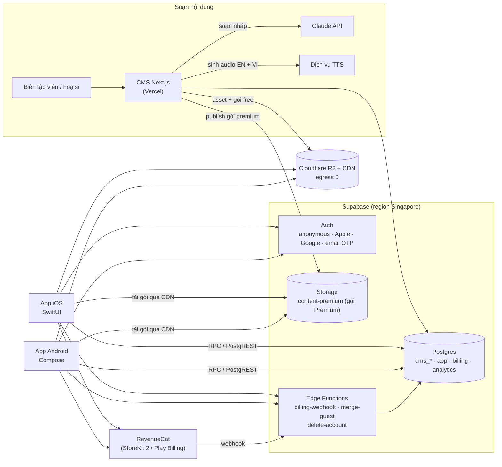
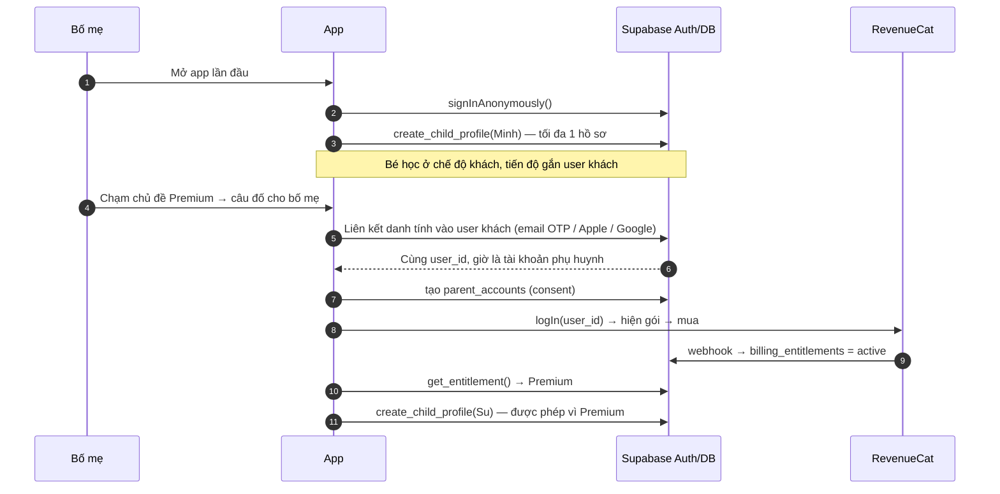

# Science Kids — Tóm tắt PRD và Technical plan

> **Trạng thái:** bản nháp để review, 28/10/2026, đã qua một vòng review độc lập (các sửa đổi ghi ngày 28/10). Chưa publish artifact; khi chốt sẽ publish như PRD.
> **Cách đọc nhãn:** *(PRD)* = đã chốt trong prd.md · *(canvas)* = Duy đã duyệt trên canvas thiết kế nhưng chưa ghi vào PRD · *(đề xuất)* = từ syllabus-progression hoặc plan này, chưa chốt.
> Nguồn: [prd.md](prd.md) · [syllabus.md](syllabus.md) · [syllabus-progression.md](syllabus-progression.md) · thiết kế [design/play-ui/](design/play-ui/project/) (canvas https://claude.ai/artifact/MLvDKD33FWJ7aTMS7XX3Zk).
> Quy ước kỹ thuật theo cách bạn đang làm ở ise_center: Supabase CLI migrations, Next.js + TanStack Query + zod, Vercel.

---

# Phần A — Tóm tắt PRD

## A1. Sản phẩm và các quyết định đã chốt

**Science Kids** (tên app chưa chốt) là app học khoa học song ngữ Anh–Việt cho trẻ 5–11 tuổi. Syllabus bám sườn primary science của Oak National Academy (UK); toàn bộ kịch bản, hình, âm thanh và thiết kế tự làm.

| Hạng mục | Đã chốt |
| --- | --- |
| Nền tảng | iOS native (Swift/SwiftUI) + Android native (Kotlin/Jetpack Compose). Không dùng React Native |
| Backend | **Supabase, chốt 28/10** (Postgres, Auth, Storage, Edge Functions) + Cloudflare R2 cho file. CMS Next.js lùi sang GĐ 2; MVP soạn nội dung bằng markdown + CLI publish (B8) |
| Thứ tự nền tảng *(chốt 28/10)* | **iOS trước, có iPad ngay từ đầu**; Android làm sau khi iOS vào beta |
| Thị trường | Phụ huynh VN đại trà và trường quốc tế / trung tâm tiếng Anh; chỉ khác chế độ ngôn ngữ mặc định |
| Ngôn ngữ | Tiếng Anh là chính; tiếng Việt là phụ đề và giải thích. **Giọng đọc có cả EN và VI** (đổi 28/10, vì bé 5–7 chưa đọc được chữ tiếng Việt) |
| Nội dung | Oak chỉ là sườn (chủ đề, thứ tự, mục tiêu, từ vựng, misconception). App chỉ là renderer của nội dung JSON đã duyệt |
| Giá | Freemium: chủ đề đầu tiên của mỗi nhóm tuổi miễn phí; Premium theo tháng hoặc năm |
| Style hình ảnh *(canvas, 27/10)* | Style E "Giấy cắt Đông Hồ": giấy cắt nhiều lớp, không nét viền, màu khoáng Đông Hồ, chữ Phudu + Be Vietnam Pro. Cần ghi vào PRD mục 8 |

## A2. Người dùng

| Nhóm | Tuổi / khung Oak | Đặc điểm thiết kế |
| --- | --- | --- |
| Explorer | 5–7 · Year 1–2 | Chưa đọc thạo; mascot đọc to; chạm ≥ 72px *(canvas)*; đáp án bằng hình; không điểm số |
| **Discoverer (pilot)** | 7–9 · Year 3–4 | Câu EN ≤ 8–10 từ, phụ đề VI bật sẵn; chạm ≥ 56px *(canvas)*; sao, streak, huy hiệu *(PRD)*; XP, thẻ sưu tầm, thử thách tuần *(canvas, mở rộng so với PRD)* |
| Scientist | 9–11 · Year 5–6 | Câu dài hơn, VI ẩn; chạm ≥ 48px *(canvas)*; thí nghiệm công bằng, chọn bằng chứng, nhật ký |
| Phụ huynh | — | PIN, báo cáo tuần, giới hạn thời gian, quản lý hồ sơ con và gói |
| Giáo viên / trung tâm | GĐ 3 | Ngoài MVP |

Trẻ dưới 13 tuổi: không quảng cáo hành vi, dữ liệu tối thiểu, mọi đăng ký qua phụ huynh.

## A3. Phạm vi MVP

| Tính năng | Ghi chú |
| --- | --- |
| Onboarding | Bố mẹ chọn chế độ ngôn ngữ (Song ngữ · EN trước · VI trước) *(PRD)*, giọng đọc (chỉ EN · chỉ VI · cả hai, 28/10) và tạo hồ sơ con (tên gọi, hình đại diện, lớp → nhóm tuổi) *(canvas; PRD nói "chọn tuổi")* |
| Vòng lặp bài học | Khởi động (2–3 câu ôn; giãn cách 1 ngày · 1 tuần · 1 tháng là *đề xuất*) → Học → Chơi (mini-game, *canvas*) → Quiz 6 câu → Thưởng → Ôn lại |
| Quiz engine | Chọn một, chọn nhiều, đúng/sai, điền từ (ngân hàng từ), câu hình, gắn nhãn, sắp thứ tự; giải thích sau mỗi câu; 1 câu bắt quan niệm sai |
| Từ vựng | Thẻ lật EN–VI sinh từ keywords của bài, nghe được cả EN lẫn VI |
| Gamification | PRD: sao, streak, huy hiệu; không xếp hạng, không loot box. Mở rộng trên canvas: sao 3 mức *(đề xuất)*, XP, chuỗi ngày có ngày nghỉ, thẻ sưu tầm, thử thách tuần — Duy cần xác nhận phạm vi MVP (B18) |
| Tài khoản | Chế độ khách cho gói free; tài khoản phụ huynh + nhiều hồ sơ con cho Premium |
| Freemium | Mở khoá cần đăng ký phụ huynh rồi mới thanh toán qua App Store / Google Play |
| Góc phụ huynh | PIN, báo cáo tuần theo từng bé, giới hạn phút mỗi ngày, chế độ ngôn ngữ, quản lý hồ sơ và gói |
| Media | Hình tĩnh + audio EN và VI ở MVP; animation đầy đủ ở GĐ 2 |

Để sau: ôn tập thích ứng (GĐ 2), offline trọn chủ đề (GĐ 2), lớp học giáo viên (GĐ 3), thí nghiệm tại nhà (GĐ 3).

## A4. Mô hình tài khoản (PRD mục 6)

- 1 gia đình = **1 tài khoản phụ huynh + nhiều hồ sơ con**. Hồ sơ con không có email/mật khẩu.
- Gói free chạy ở **chế độ khách**, không đăng ký, **1 hồ sơ con**. PRD ghi tiến độ khách "lưu theo thiết bị"; plan này đề xuất lưu cả trên server dưới user ẩn danh để nâng cấp không mất dữ liệu (xem B10, B12) — **đây là thay đổi so với PRD, cần Duy chốt**.
- Hồ sơ con thứ 2 trở đi chỉ có ở Premium.
- Mở khoá Premium bắt buộc **đăng ký tài khoản phụ huynh trước khi thanh toán**. Hồ sơ và tiến độ của chế độ khách chuyển sang nguyên vẹn.

## A5. Nội dung và sư phạm

- Syllabus: Explorer ~56 bài, Discoverer ~67 bài, Scientist ~78 bài; mỗi chủ đề 4–8 bài; bài 5–12 phút; nhịp khuyến nghị 3 bài/tuần.
- Pilot GĐ 0: Discoverer Year 3, chủ đề 1–6, khoảng 34 bài, theo thứ tự Ăn uống lành mạnh → Bộ xương và cơ bắp → Ánh sáng → Lực và nam châm → Cây → Đá và đất. Bài mẫu chuẩn chất lượng: "Ăn uống lành mạnh — bài 1".
- Mỗi chủ đề có `strand` (6 mạch), `level` (Mức 1–5), điểm độ khó theo rubric 5 tiêu chí, chủ đề tiên quyết.
- Quiz 6 câu xếp dễ → khó theo DOK; Discoverer phân bổ DOK 1·2·3 = 2·3·1, 3–4 lựa chọn, 1 câu misconception; câu 1 luôn DOK 1.
- Khởi động: 1 câu từ bài trước (~1 ngày), 1 câu ~1 tuần, 1 câu ~1 tháng khi đã có.
- **Đề xuất chưa chốt:** ngưỡng đạt 5/6 với sao 3 mức (⭐ hoàn thành · ⭐⭐ đạt ≥ 5/6 · ⭐⭐⭐ đạt lại ≥ 5/6 sau ít nhất 1 ngày), huy hiệu theo 6 mạch thay cho 15 Big Questions.

## A6. Thiết kế đã có

Canvas Claude Design (nguồn trong [design/play-ui/project/](design/play-ui/project/)): style E áp cho cả 3 nhóm tuổi. Discoverer có đủ **17 màn có tương tác và animation**: Chào mừng · Hồ sơ của bé · Chọn hồ sơ · Trang chủ · Chủ đề · Nhờ bố mẹ mở khoá · Đăng ký phụ huynh · Khởi động · Học · Chơi · Quiz câu 5 · Quiz câu 6 · Thưởng · Bộ thẻ · Huy hiệu · Từ vựng · Góc phụ huynh. Explorer và Scientist mỗi nhóm có 5 màn (Trang chủ, Học, Chơi, Quiz, Thưởng). Bộ animation chung: giấy đặt xuống, đóng triện, tờ giấy trượt lên, giấy vụn chỉ ở màn Thưởng, tắt khi máy bật giảm chuyển động.

## A7. Roadmap và chỉ số

| Giai đoạn | Thời gian | Nội dung | Gate |
| --- | --- | --- | --- |
| GĐ 0 · Nội dung | T11/2026 – 16/1/2027 | Syllabus, nội dung pilot Year 3, schema + CLI publish (CMS lùi GĐ 2) | Nội dung Y3 sẵn sàng 16/1/2027 |
| GĐ 1 · MVP | T1 – T4/2027 *(PRD)*; B16 tính lại là 19/1 – 29/5 + beta 4 tuần → gate cuối T6 | 2 app native: vòng lặp bài học, quiz, gamification, góc phụ huynh | Beta 50 gia đình đạt |
| GĐ 2 · Mở rộng | T4 – T7/2027 *(PRD)*; theo B16 là T7 – T9 | Đủ Year 1–6, ôn thích ứng, offline, animation đầy đủ, CMS Next.js | Lên store |

North star: số bài hoàn thành có exit quiz đạt ngưỡng mỗi tuần (PRD đang ghi ≥ 4/6, đề xuất đổi ≥ 5/6). Chỉ số khác: hoàn thành bài đầu trong 24h ≥ 60%, D7 ≥ 35%, điểm quiz TB ≥ 4,5/6, ≥ 40 từ "đã nhớ"/trẻ/tháng, ≥ 50% phụ huynh mở báo cáo tuần, chuyển đổi trả phí ≥ 8%. Gate beta: D7 ≥ 25%, quiz ≥ 4/6, ≥ 3 bài/tuần/trẻ.

## A8. Việc còn mở có ảnh hưởng tới kỹ thuật

- Tiến độ chế độ khách lưu trên máy (PRD) hay trên server dưới user ẩn danh (plan)? Kéo theo pháp lý và hành vi khi gỡ app.
- Góc phụ huynh trên web: PRD mục 7 có "Góc phụ huynh (web)" trong kiến trúc; plan này đưa ra khỏi MVP (Góc phụ huynh nằm trong app) — cần xác nhận.
- Phạm vi gamification MVP: PRD chỉ có sao, streak, huy hiệu; canvas thêm XP, thẻ sưu tầm, thử thách tuần.
- Khi nào nhắc bố mẹ đăng ký để giữ tiến độ (PRD mục 6, câu hỏi mở).

- Tên app (bundle id, domain, tên trên store) và phong cách mascot.
- Giá gói tháng/năm; có dùng thử miễn phí không (PRD đo "dùng thử → trả phí" nhưng thiết kế chưa có dùng thử).
- Ngưỡng đạt 4/6 hay 5/6, sao 3 mức, huy hiệu theo mạch hay Big Questions.
- Số hồ sơ con tối đa của Premium; xử lý khi hết hạn Premium mà đang có từ 2 hồ sơ; có mức "đã đăng ký nhưng không trả phí" không.
- Cách đăng nhập phụ huynh (Apple / Google / email OTP); PIN ở chế độ khách.
- Đội làm 2 app native (người, thời gian) — xem B17.

---

# Phần B — Technical plan

## B1. Nguyên tắc kiến trúc

1. **App là renderer, nội dung là dữ liệu.** Mọi bài học, quiz, mini-game, từ vựng nằm trong gói JSON có phiên bản; app không hard-code nội dung. Thêm chủ đề không cần ra bản app mới.
2. **Một nguồn sự thật cho quy tắc.** Cách tính sao, XP, chuỗi ngày, thẻ thưởng chạy trên server (hàm Postgres) để iOS và Android không lệch nhau. App tính tạm để hiện ngay (optimistic), server trả kết quả chốt.
3. **Offline-first cho tiến độ.** Mọi lần làm bài ghi xuống máy trước, đồng bộ sau bằng hàng đợi idempotent. Mạng chập chờn không làm mất sao của bé.
4. **Hai app native giống nhau nhờ hợp đồng chung:** JSON Schema nội dung, design tokens và bộ test vector dùng chung, sinh code cho Swift và Kotlin.
5. **Riêng tư theo mặc định.** Không SDK quảng cáo, không analytics bên thứ ba; dữ liệu trẻ tối thiểu; quyền truy cập chặn bằng RLS ngay ở database.
6. **Tương thích ngược.** Thứ tự phát hành luôn là migration → gói nội dung / CMS → app mobile. Mọi thay đổi DB và schema nội dung phải chạy được với bản app đang có trên store.

## B2. Sơ đồ tổng thể



## B3. Cấu trúc repo (monorepo)

Repo `science-kids` hiện chỉ có tài liệu và thiết kế. Đề xuất tổ chức thành monorepo; phần JS dùng Turborepo + Yarn workspaces như ise_center, còn iOS/Android build bằng công cụ riêng nhưng dùng code sinh ra từ `packages/`.

```
science-kids/
├── apps/
│   ├── ios/                 # Xcode project + Swift Packages (DesignSystem, ContentKit, LessonPlayer…)
│   ├── android/             # Gradle multi-module (core-*, feature-*)
│   └── cms/                 # GĐ 2: Next.js 15 + Tailwind 4 + TanStack Query + zod
├── tools/
│   └── content-cli/         # MVP: validate markdown → JSON, sinh TTS, build gói, upload (Node/TS)
├── packages/
│   ├── content-schema/      # JSON Schema nội dung + zod + model Swift/Kotlin sinh tự động + fixtures + test vectors
│   ├── design-tokens/       # tokens.json (màu, chữ, bán kính, bóng, motion) → Swift, Kotlin, CSS
│   └── shared/              # Kiểu TypeScript sinh từ Supabase, hằng số dùng chung
├── database/supabase/
│   ├── migrations/          # YYYYMMDDHHMMSS_<tên>.sql (giờ VN)
│   ├── functions/           # Edge Functions (Deno)
│   ├── tests/               # pgTAP cho RPC và RLS
│   ├── seed.sql
│   └── config.toml
├── design/                  # canvas thiết kế (đã có)
├── docs/                    # prd.md, syllabus*.md, technical-plan.md (có thể chuyển dần vào đây)
└── .github/workflows/
```

**MVP không làm codegen** (28/10, cắt bớt): model Swift/Kotlin viết tay theo JSON Schema và được kiểm bằng cách decode toàn bộ fixtures trong CI; tokens xuất bằng một script nhỏ chạy tay khi đổi. Codegen tự động xem lại ở GĐ 2 nếu schema đổi thường xuyên. Turborepo chỉ cần khi có từ 2 app JS; với riêng CMS, `yarn workspaces` là đủ.

## B4. Lớp nội dung

### B4.1 Cây nội dung

```
age_group (explorer | discoverer | scientist)
└── topic            # chủ đề: strand, level, difficulty, prerequisites, is_free, oak_unit_ref
    └── lesson       # bài: stage (opener | core | apply | review), objective "I can…", ~phút
        ├── warmup   # 2–3 quiz_item tham chiếu bài cũ (chọn lúc chạy theo lịch giãn cách)
        ├── learn    # danh sách block học
        ├── play     # 1 mini-game
        ├── quiz     # đúng 6 quiz_item
        ├── vocab    # 4–8 vocab_term
        └── reward   # thẻ sưu tầm, huy hiệu liên quan
```

Mọi chuỗi hiển thị là cặp song ngữ: `{"en": "...", "vi": "..."}`. Chuỗi đọc to có thêm `audio: {"en": <asset>, "vi": <asset>}`; cả hai thứ tiếng đều có giọng (đổi 28/10). Hình có `alt` song ngữ cho VoiceOver/TalkBack.

**Giọng đọc là lựa chọn của hồ sơ** (`child_profiles.voice_mode`: `en` · `vi` · `both`), bố mẹ chọn lúc thiết lập và đổi trong Góc phụ huynh. `both` = EN đọc trước, VI đọc nối theo; `en` hoặc `vi` chỉ phát một thứ tiếng, nút nghe thứ tiếng kia vẫn có để chạm khi cần. Mặc định gợi ý lúc onboarding lấy từ `rules`: Song ngữ → `both`, EN-first → `en`, VI-first → `both`; Explorer luôn gợi ý `both`. Lời mascot, gợi ý và giải thích đáp án (phần lớn là VI) cũng có audio, vì bé nhỏ nhận gợi ý bằng tai. Gói nội dung luôn chứa cả hai clip; app chỉ tải trước clip của thứ tiếng đang bật.

### B4.2 Kiểu block (registry)

Mỗi block có `type` và `version`. App gặp `type` không biết thì bỏ qua block đó và báo analytics, không crash. Bước publish (CLI ở MVP, CMS ở GĐ 2) chặn block mà `min_app_version` của nó cao hơn bản app đang phổ biến.

| Nhóm | `type` | Dùng ở màn thiết kế |
| --- | --- | --- |
| Học | `explore_groups` (chạm từng nhóm, mỗi nhóm có câu + món ví dụ) | Discoverer Học |
| Học | `hotspot_image` (chạm điểm trên hình để mở nhãn) | Explorer Học |
| Học | `timeline_slider` (kéo thanh giai đoạn) | Scientist Học |
| Học | `sentence_card`, `word_list` | mọi nhóm |
| Chơi | `sort_into_groups` (chạm–chạm xếp vào nhóm) | Explorer Chơi |
| Chơi | `build_tray` (chọn món vào mâm, ràng buộc theo nhóm chất) | Discoverer Chơi |
| Chơi | `fair_test` (xếp biến vào Thay đổi / Đo / Giữ nguyên) | Scientist Thí nghiệm |
| Chơi | `label_diagram` (GĐ 2) | — |
| Quiz | `single_choice`, `multi_choice`, `true_false`, `fill_blank_bank`, `fill_blank_free` (Scientist), `order_sequence`, `picture_bar_chart` (đọc biểu đồ cột dạng tranh, Discoverer), `evidence_choice` (Scientist) | Quiz, Khởi động, Quiz câu 6 |
| Quiz | `label_diagram` | GĐ 2 (cả Chơi và Quiz) |

Trường chung của `quiz_item`: `id`, `format`, `dok` (1–3), `prompt`, `options[]` (mỗi lựa chọn có `id`, `label`, `image?`, `correct`), `hint` (gợi ý, thường là VI), `explanation_correct`, `explanation_wrong`, `misconception_id?`, `p_correct?` (điền sau beta), `audio`. `topic` và `lesson` có cờ `sensitive` (nội dung dậy thì, PRD mục 11) để app ẩn cho tới khi phụ huynh bật.

**Id ổn định:** id của chủ đề, bài, block, câu quiz, từ vựng là UUID cấp một lần (ở MVP: biên tập ghi `id` trong frontmatter markdown, CLI sinh nếu thiếu và ghi ngược lại file) và không đổi qua các lần publish; sửa nội dung giữ id, bỏ nội dung thì `archived` chứ không xoá, để `lesson_progress` và `vocab_progress` không mồ côi. `p_correct` hiệu chỉnh theo cặp (`item_id`, `content_version`).

**Hình dạng `data` của block** (ví dụ `explore_groups`; các block khác theo cùng kiểu, định nghĩa đầy đủ trong `packages/content-schema`):

```json
{
  "type": "explore_groups", "version": 1,
  "prompt": {"en": "Tap each group", "vi": "Chạm từng nhóm"},
  "groups": [
    {"id": "carb", "label": {"en": "Carbohydrates", "vi": "Chất bột đường"}, "color": "vang_hoe",
     "sentence": {"en": "Carbohydrates give us energy.", "vi": "Chất bột đường cho ta năng lượng.", "audio": {"en": "sha256…", "vi": "sha256…"}},
     "image": "sha256…", "examples": [{"en": "rice", "vi": "cơm"}]}
  ],
  "complete_when": "all_seen"
}
```

### B4.3 Gói nội dung (content pack)

- **Catalog** `catalog/v1/manifest.json`: danh sách nhóm tuổi, chủ đề, phiên bản hiện hành, `is_free`, đường dẫn gói, `sha256`, `size`, `min_app_version`, `schema_version`, và `rules` (ngưỡng đạt, khoảng ôn, số ngày nghỉ/tuần, số hồ sơ…). App tải manifest khi mở, có ETag để không tải lại.
- **Gói chủ đề** `topics/<topic_id>/<version>/pack.json`: toàn bộ bài của chủ đề, tham chiếu asset bằng hash.
- **Asset** `assets/<sha256>.<ext>`: đặt tên theo nội dung nên cache vĩnh viễn, chủ đề sau dùng lại không tải lại.
- **Nơi đặt file (28/10, sau research free tier):** asset (hình, audio — phần lớn dung lượng) và gói free đặt trên **Cloudflare R2** (10 GB free, **egress 0 đồng**, có CDN); gói premium `pack.json` (nhỏ, vài trăm KB) đặt ở Supabase Storage bucket riêng tư `content-premium`, app tải bằng token của user qua Storage RLS kiểm `billing_entitlements` (B6). Lý do: gói free của Supabase chỉ có 5 GB egress/tháng, 50 gia đình tải vài chủ đề 15 MB là hết; R2 không tính egress. Asset dùng chung để public vì tách riêng không có giá trị bảo vệ đáng kể.
- **Phiên bản:** một bản publish là bất biến. App giữ phiên bản đã tải cho tới khi bé học xong bài đang dở, rồi mới chuyển bản mới. Mỗi lần làm bài ghi `content_version` để báo cáo và hiệu chỉnh `p_correct` không bị lẫn phiên bản.
- **Ước lượng dung lượng:** mỗi bài khoảng 15 hình WebP (≈ 60 KB) + 60 clip audio EN và VI (≈ 30 KB), tức khoảng 3 MB/bài, khoảng 15 MB/chủ đề. MVP tải theo chủ đề khi bé mở; GĐ 2 cho phụ huynh tải trước để học offline.
- **Schema:** `packages/content-schema` giữ JSON Schema (nguồn), zod (CLI/CMS validate), model Swift `Codable` và Kotlin `@Serializable` sinh tự động. Đổi schema kiểu phá vỡ thì tăng `schema_version`; manifest khai báo `min_app_version` để app cũ hiện "Cập nhật app để học chủ đề này".

### B4.4 Luật chấm và thưởng (v1, tham số trong `rules`)

Phần này là cái mà engine, test vector và pgTAP cùng dựa vào; sprint 1 không bắt đầu được nếu thiếu.

| Luật | v1 |
| --- | --- |
| Điểm một câu | 1 điểm nếu đúng ở lần thử đầu. Sai thì hiện gợi ý, cho thử lại (tối đa `max_tries`, mặc định 2), rồi hiện giải thích; không trừ điểm, không chặn bài, nhưng lần thử sau không được điểm |
| Chọn nhiều | Đúng khi tập chọn bằng đúng tập đáp án (all-or-nothing) |
| Điền từ, sắp thứ tự, gắn nhãn | Đúng khi khớp hoàn toàn; sắp thứ tự có thể cho điểm khi đúng ≥ `partial_order_min` (mặc định tắt) |
| Điểm bài | `score` = số câu đúng / 6. Khởi động không tính điểm |
| Sao | ⭐ hoàn thành bài; ⭐⭐ `score ≥ pass_threshold` (`4/6` theo PRD hiện tại, `5/6` theo đề xuất, là tham số); ⭐⭐⭐ đạt lại `pass_threshold` ở lần làm cách lần đạt đầu ≥ `mastery_gap_days` (mặc định 1) |
| Ôn nhanh / siêu sao *(đề xuất syllabus §10)* | `score ≤ 3/6` → `lesson_progress.needs_quick_review = true`, app gợi ý ôn trước bài sau; 6/6 ở 2 bài liên tiếp → `superstar_unlocked = true`, mở câu DOK 3 tuỳ chọn (nội dung GĐ 2) |
| XP | `xp_per_correct` 10 · `xp_lesson_complete` 20 · `xp_game_complete` 10 · ôn lại đạt thành thạo 20; XP chỉ cộng, không trừ |
| Chuỗi ngày | Ngày tính theo `local_date` của bé (B5.1); một ngày "đã học" khi hoàn thành ≥ 1 bài; mỗi tuần ISO được `rest_days_per_week` (1) ngày không học mà không đứt chuỗi |
| Khởi động | Cần 2–3 câu: 1 câu từ bài gần nhất, 1 câu từ bài cách ~7 ngày, 1 câu cách ~30 ngày; thiếu lịch sử thì lấy câu từ các bài đã học gần nhất; bài đầu tiên của bé không có khởi động (màn "Hôm nay bắt đầu") |
| Dừng giữa bài | Lưu `attempt_id`, bước và các câu đã trả lời trên máy; mở lại tiếp đúng chỗ; attempt bỏ dở quá 7 ngày thì huỷ |

## B5. Lớp dữ liệu — Database (Supabase Postgres)

### B5.1 Quy ước (giống ise_center)

- Migration: `database/supabase/migrations/YYYYMMDDHHMMSS_<tên>.sql`, giờ VN (`TZ='Asia/Ho_Chi_Minh' date +"%Y%m%d%H%M%S"`). Không tự `db push`; Duy review và chạy tay.
- Bảng `snake_case`. Bảng soạn nội dung có tiền tố `cms_`; bảng dữ liệu app không tiền tố; bảng thanh toán `billing_`; analytics `analytics_`.
- Mỗi `CREATE TABLE public.*` kèm `ENABLE ROW LEVEL SECURITY`, policy và `GRANT` tường minh cho `authenticated` / `service_role` (không grant `anon` trừ khi cần đọc công khai).
- RPC: tham số tiền tố `p_`, trả `jsonb` dạng `{ success, error_code, error, data }`, `SECURITY DEFINER` + `SET search_path = ''`, tên bảng đầy đủ `public.xxx`.
- Khoá chính `uuid` (`gen_random_uuid()`); id lần làm bài do app sinh (UUID v4, đủ cho idempotent; không cần v7 vì Swift/Kotlin không có sẵn).
- Thời gian lưu `timestamptz`. Chuỗi ngày và báo cáo tuần tính theo **múi giờ của hồ sơ** (`child_profiles.timezone`, app gửi khi tạo và khi đổi): server tính `local_date` từ `completed_at` server-side và `timezone`, không tin ngày do máy gửi, nên chỉnh giờ máy hay hai máy khác múi giờ không làm lệch.

### B5.2 Bảng soạn nội dung (GĐ 2, trừ `content_publishes`)

| Bảng | Cột chính | Ghi chú |
| --- | --- | --- |
| `cms_age_groups` | `id`, `name`, `years[]`, `rules jsonb` | Quy tắc theo nhóm: số lựa chọn, DOK, vùng chạm |
| `cms_strands` | `id`, `name_en`, `name_vi` | 6 mạch kiến thức |
| `cms_topics` | `id`, `age_group_id`, `order`, `title jsonb`, `strand_id`, `level`, `difficulty jsonb`, `prerequisite_topic_ids uuid[]`, `is_free`, `oak_unit_ref`, `status` | |
| `cms_lessons` | `id`, `topic_id`, `order`, `stage`, `title jsonb`, `objective jsonb`, `key_points jsonb`, `est_minutes`, `status` | |
| `cms_blocks` | `id`, `lesson_id`, `section` (learn · play), `order`, `type`, `version`, `data jsonb` | `data` validate bằng zod theo `type` |
| `cms_quiz_items` | `id`, `lesson_id`, `slot` (warmup · quiz), `order`, `format`, `dok`, `data jsonb`, `misconception_id`, `p_correct` | |
| `cms_misconceptions` | `id`, `topic_id`, `statement jsonb`, `correction jsonb`, `source` | |
| `cms_vocab_terms` | `id`, `lesson_id`, `term_en`, `meaning_vi`, `example jsonb`, `image_asset_id`, `audio_en_asset_id`, `audio_vi_asset_id` | |
| `cms_assets` | `id`, `sha256`, `kind` (image · audio), `lang` (en · vi, với audio), `voice_id`, `storage_path`, `alt jsonb`, `credit`, `license`, `width`, `height`, `duration_ms` | |
| `cms_collectibles`, `cms_badges` | `id`, `name jsonb`, `image_asset_id`, `fact jsonb`, `rule jsonb` | Thẻ sưu tầm, huy hiệu |
| `cms_reviews` | `id`, `entity`, `entity_id`, `from_status`, `to_status`, `reviewer_id`, `comment`, `created_at` | Lịch sử duyệt |
| `content_publishes` (MVP; tên cũ `cms_publishes`) | `id`, `topic_id`, `version`, `schema_version`, `pack_path`, `sha256`, `size`, `git_sha`, `published_by`, `published_at`, `notes` | Bất biến; bảng duy nhất của nhóm này có ở MVP |
| `cms_staff` | `user_id`, `role` (admin · editor · reviewer · illustrator) | RLS cho CMS dựa vào bảng này |

Trạng thái nội dung: `draft → in_review → approved → published` (và `archived`). Chỉ `reviewer`/`admin` chuyển sang `approved`; chỉ `admin` publish.

### B5.3 Bảng dữ liệu app

| Bảng | Cột chính | Ghi chú |
| --- | --- | --- |
| `parent_accounts` | `user_id` (PK = `auth.users.id`), `email`, `locale`, `country`, `consent_version`, `consent_at`, `created_at` | Chỉ có khi đã đăng ký (user không anonymous) |
| `child_profiles` | `id`, `owner_id` (auth user: khách hoặc phụ huynh), `display_name`, `avatar`, `grade`, `age_group`, `language_mode`, `daily_limit_min`, `voice_mode` (en · vi · both), `timezone`, `locked_reason` (null · premium_expired), `created_at`, `archived_at` | Không lưu ngày sinh, ảnh, giọng nói |
| `lesson_attempts` | `id` (UUID app sinh), `child_id`, `lesson_id`, `content_version`, `started_at`, `completed_at`, `score`, `max_score`, `duration_s`, `xp`, `install_id` (id ngẫu nhiên app sinh khi cài, không phải định danh thiết bị), `client_created_at` | Idempotent theo `id` |
| `quiz_answers` | `attempt_id`, `item_id`, `slot`, `correct`, `answer jsonb`, `time_ms`, `hint_used`, `tries` | Dữ liệu để hiệu chỉnh `p_correct` |
| `lesson_progress` | `child_id`, `lesson_id`, `stars` (0–3), `best_score`, `first_pass_at`, `mastered_at`, `last_completed_at`, `attempts_count`, `needs_quick_review`, `superstar_unlocked` | Do RPC cập nhật, app chỉ đọc |
| `activity_days` | `child_id`, `local_date`, `minutes`, `lessons_completed`, `is_rest_day` | Chuỗi ngày, biểu đồ phút, giới hạn phút |
| `child_collectibles` | `child_id`, `collectible_id`, `source_lesson_id`, `earned_at`, `seen_at` | Thẻ sưu tầm, cờ "Mới" |
| `child_badges` | `child_id`, `badge_id`, `progress jsonb`, `earned_at` | |
| `vocab_progress` | `child_id`, `term_id`, `status` (new · review · known), `seen_count`, `last_seen_at`, `next_review_at` | `next_review_at` dùng ở GĐ 2 |
| `weekly_challenges` | `child_id`, `week_start`, `target`, `done`, `reward_collectible_id`, `claimed_at` | |
| `billing_entitlements` | `owner_id`, `entitlement` (premium), `product_id`, `store` (app_store · play_store), `status`, `period` (month · year), `expires_at`, `original_transaction_id`, `updated_at` | Ghi bởi webhook, app chỉ đọc |
| `billing_events` | `id`, `source`, `payload jsonb`, `received_at`, `processed_at` | Lưu thô để đối soát |
| `analytics_events` | `id`, `owner_id`, `child_id`, `name`, `props jsonb`, `occurred_at`, `app_version`, `platform` | Bảng thường, xoá dòng cũ hơn 180 ngày bằng cron; partition khi vượt vài chục triệu dòng |
| `app_config` | `key`, `value jsonb`, `min_app_version` | Cờ tính năng, thông báo bảo trì, và `rules.<age_group>` |
| `rate_counters` | `owner_id`, `bucket`, `window_start`, `count` | Đếm cho giới hạn tốc độ trong RPC |

**`rules` có một nguồn:** MVP là file `content/rules.json` trong repo (GĐ 2 chuyển vào `cms_age_groups.rules`); lúc publish, CLI chép sang `app_config` (`rules.<age_group>`, RPC đọc ở đây) và vào manifest (app đọc để tính tạm). Hai bản chỉ là bản sao của cùng một lần publish.

View tổng hợp (security invoker): `child_stats` (tổng sao, XP, chuỗi hiện tại), `parent_weekly_report` (tuần ISO theo múi giờ hồ sơ). KPI nội bộ ở MVP là vài câu SQL lưu trong `docs/`, chưa cần view riêng.

### B5.4 RLS (tóm tắt)

- `child_profiles` và mọi bảng con: `owner_id = auth.uid()` (bảng con join qua `child_profiles`). Anonymous user cũng là role `authenticated`, nên cùng một policy dùng cho cả khách và phụ huynh.
- Ghi vào `lesson_attempts`, `lesson_progress`, `activity_days`, `child_*` **chỉ qua RPC** (không grant INSERT/UPDATE trực tiếp), để luật tính sao không bị app sửa.
- `billing_entitlements`: app chỉ SELECT dòng của mình; chỉ `service_role` (webhook) được ghi.
- Bảng `cms_*`: chỉ user có dòng trong `cms_staff`; quyền theo `role`.
- `analytics_events`: app chỉ INSERT qua RPC `log_events` (giới hạn kích thước `props`), không SELECT.
- **Giới hạn tốc độ và chống lạm dụng:** Postgres không có rate limit sẵn, nên các RPC ghi (`submit_attempts`, `log_events`, `create_child_profile`) đếm trong `rate_counters` theo `owner_id` và cửa sổ 1 giờ, vượt ngưỡng thì trả `rate_limited`. Supabase giới hạn đăng nhập ẩn danh 30 lần/giờ/IP mặc định — phải nâng cho Wi-Fi trường và trung tâm. Cron hằng tuần xoá user ẩn danh không có hồ sơ hoặc không hoạt động > 90 ngày (Supabase không tự dọn).

### B5.5 Hàm (RPC) chính

| RPC | Việc làm |
| --- | --- |
| `create_child_profile(p_display_name, p_avatar, p_grade, p_language_mode)` | Kiểm tra giới hạn: chưa Premium (hoặc anonymous) thì tối đa 1 hồ sơ đang hoạt động; Premium tối đa `rules.max_profiles`. Map lớp → nhóm tuổi |
| `update_child_profile(p_child_id, p_patch jsonb)` | Tên, avatar, lớp, chế độ ngôn ngữ, giọng đọc, giới hạn phút |
| `archive_child_profile(p_child_id)` | Ẩn hồ sơ (giữ dữ liệu); xoá hẳn qua `delete-account` |
| `submit_attempts(p_attempts jsonb)` | Nhận 1..n lần làm bài từ hàng đợi offline, idempotent theo `id`. Trong một transaction: ghi attempt + answers → tính lại `lesson_progress` (sao), `activity_days`, chuỗi ngày, XP, thẻ, huy hiệu, thử thách tuần → trả về phần thưởng chốt cho từng attempt |
| `get_home(p_child_id)` | Hành trình (chủ đề, khoá/mở theo thứ tự và quyền, `locked_reason`), bài tiếp theo, chuỗi ngày, sao, thử thách tuần, **số phút đã học hôm nay** (để máy thứ hai áp đúng giới hạn), cờ ôn nhanh |
| `get_warmup_items(p_child_id, p_lesson_id)` | Chọn 2–3 câu khởi động theo lịch giãn cách (1 ngày · 1 tuần · 1 tháng) từ các bài đã học |
| `set_vocab_status(p_child_id, p_term_id, p_status)` | "Đã nhớ" / "Ôn lại" |
| `get_parent_report(p_child_id, p_week_start)` | Số bài, phút theo ngày, quiz đúng, từ mới, đang học, nên ôn (từ câu sai và misconception) |
| `log_events(p_events jsonb)` | Ghi analytics theo lô |
| `get_entitlement()` | Trạng thái Premium của tài khoản hiện tại |

Quy tắc tính toán lấy tham số từ `rules` (ngưỡng đạt, khoảng ôn để thành thạo, số ngày nghỉ mỗi tuần) để đổi quyết định 4/6 ↔ 5/6 mà không cần ra bản app. Chuỗi ngày: một ngày tính là "đã học" khi có ít nhất 1 bài hoàn thành theo `local_date`; mỗi tuần ISO được 1 ngày nghỉ không làm đứt chuỗi.

## B6. Lớp API

App nói chuyện với backend qua 3 kênh:

1. **PostgREST + RPC** (Supabase SDK): đọc dữ liệu theo RLS, ghi qua RPC ở B5.5.
2. **Storage + CDN:** tải manifest, gói free và asset trực tiếp; gói premium qua URL ký.
Gói premium không cần Edge Function riêng: bucket `content-premium` để riêng tư và dùng **Storage RLS** (policy `SELECT` cho `authenticated` khi `billing_entitlements` của `auth.uid()` đang `active`/`grace`); app tải bằng token của user. Đổi lại so với bản đầu (28/10): bỏ `content-url`.

3. **Edge Functions (Deno)** cho việc cần secret, gọi dịch vụ ngoài, hoặc thao tác nhiều user:

| Edge Function | Gọi từ | Việc làm |
| --- | --- | --- |
| `billing-webhook` | RevenueCat (hoặc App Store Server Notifications v2 + Google RTDN) | Xác thực chữ ký → ghi `billing_events` → cập nhật `billing_entitlements` |
| `merge-guest` | App | Khi phụ huynh đăng nhập tài khoản đã có trên máy đang có dữ liệu khách: chuyển hồ sơ/tiến độ của user khách sang tài khoản (gộp vào hồ sơ có sẵn hoặc thêm mới nếu còn chỗ) |
| `delete-account` | App (Góc phụ huynh) | Xoá tài khoản và mọi dữ liệu con (bắt buộc theo App Store); huỷ liên kết RevenueCat |
| `export-data` | App (Góc phụ huynh) | Xuất dữ liệu của gia đình — GĐ 2; MVP xử lý yêu cầu này thủ công qua email hỗ trợ |

Việc của khâu soạn nội dung (publish gói, sinh TTS, soạn nháp bằng Claude) ở MVP là **CLI chạy trên máy Duy** với `service_role` key trong biến môi trường cục bộ; GĐ 2 chuyển vào route handler của CMS. Không bao giờ mở ra cho app.

Hợp đồng API được ghi trong `docs/api/rpc.md` (giống `docs/api/crm-rpc.md` ở ise_center); mọi RPC mới hoặc đổi chữ ký phải cập nhật tài liệu và giữ chữ ký cũ cho tới khi bản app cũ hết dùng.

## B7. Lớp ứng dụng mobile

### B7.1 Kiến trúc chung (giống nhau ở 2 nền tảng)

```
UI (SwiftUI / Compose)
  └─ Feature (ViewModel: state + intent, một chiều)
       └─ Domain (engine thuần, không I/O — test bằng vector chung)
            └─ Data (Repository)
                 └─ Platform (Supabase SDK, SQLite, Storage, Audio, Billing, Keychain)
```

| Module | Nội dung |
| --- | --- |
| `DesignSystem` | Tokens style E; thành phần giấy: PaperCard, TornEdgeCard, TwoLayerButton, PaperDisc, Seal, Cartouche, PaperTag, ProgressSquares, BottomNavStrip; motion presets |
| `ContentModel` | Model sinh từ JSON Schema |
| `ContentKit` | Tải và cache manifest, gói, asset; kiểm `sha256`; chọn phiên bản |
| `LessonPlayer` | Chạy một bài theo các bước; registry `type → renderer` cho block học, mini-game, quiz |
| `MiniGames` | `ExploreGroups`, `HotspotImage`, `TimelineSlider`, `SortIntoGroups`, `BuildTray`, `FairTest` |
| `QuizEngine` | Chấm từng dạng câu, gợi ý, giải thích, thứ tự câu |
| `Rewards` | Hiển thị sao, XP, thẻ, huy hiệu; tính tạm trước khi server chốt |
| `Profiles` | Chọn hồ sơ, tạo/sửa hồ sơ, giới hạn số hồ sơ |
| `Account` | Chế độ khách, đăng ký/đăng nhập phụ huynh, gộp dữ liệu khách |
| `Billing` | RevenueCat, màn chọn gói, khôi phục giao dịch |
| `ParentArea` | Cổng phụ huynh (câu đố), PIN, báo cáo tuần, cài đặt từng bé |
| `Sync` | Hàng đợi attempt/answers/events, thử lại có backoff |
| `Audio` | Phát audio EN và VI của câu, từ, gợi ý; nối tiếp EN → VI theo `rules`; tải trước clip của bước kế tiếp |
| `Analytics` | Ghi sự kiện vào hàng đợi, gửi theo lô |

### B7.2 Engine dùng chung và test vector

Các luật phải cho cùng kết quả trên 2 nền tảng: chấm quiz từng dạng, tính sao/XP tạm, chuỗi ngày có ngày nghỉ, ràng buộc mâm cơm cân bằng, chấm thí nghiệm công bằng, chọn câu khởi động. `packages/content-schema/test-vectors/*.json` chứa input + output mong đợi; test Swift và Kotlin cùng đọc bộ này. Server dùng cùng vector trong pgTAP cho phần chốt.

### B7.3 iOS

- **iOS làm trước** (chốt 28/10); Android bắt đầu khi iOS vào beta, dùng lại schema, engine, test vector và tokens.
- Swift 6, SwiftUI, iOS 17+ (đề xuất nâng từ 16 để dùng `@Observable` và `NavigationStack` ổn định; iPad cùng mức). Swift Concurrency.
- **Universal app iPhone + iPad từ sprint 1** (B7.10): một target, một codebase, layout theo size class.
- Swift Packages theo module ở B7.1; app target mỏng.
- Lưu trữ: SQLite qua GRDB (hàng đợi sync, cache tiến độ); file gói/asset trong `Application Support`.
- Supabase: `supabase-swift` (Auth, PostgREST, Functions, Storage).
- Âm thanh: `AVAudioPlayer`/`AVAudioEngine`; session `.ambient` để không cắt nhạc của máy khi không cần.
- Đăng nhập: Sign in with Apple (AuthenticationServices), Google Sign-In, email OTP.
- Bí mật: PIN phụ huynh (hash + salt) trong Keychain.
- Phân phối: TestFlight; Kids Category trên App Store (xem B12).

### B7.4 Android

- Kotlin, Jetpack Compose, minSdk 26, targetSdk mới nhất. Coroutines + Flow.
- Gradle multi-module `core-designsystem`, `core-content`, `core-data`, `feature-lesson`, `feature-parent`…; Hilt cho DI.
- Lưu trữ: Room; DataStore cho cài đặt; file gói trong `filesDir`.
- Supabase: `supabase-kt` — thư viện cộng đồng, Supabase ghi rõ không phải thư viện chính thức và gần như một người bảo trì (rủi ro ở B17); bọc sau một interface `BackendClient` để thay được bằng PostgREST/Auth REST thuần nếu cần.
- Âm thanh: Media3 ExoPlayer.
- Đăng nhập: Credential Manager (Google), Sign in with Apple qua web flow của Supabase, email OTP.
- Bí mật: PIN trong EncryptedSharedPreferences / Keystore.
- Hiệu năng máy rẻ: không dùng filter/blur lúc chạy; bóng và vân giấy vẽ sẵn vào ảnh (đúng rủi ro đã ghi ở style E); đo trên một máy Android tầm 3–4 triệu đồng.

### B7.5 Design system và motion

- `packages/design-tokens/tokens.json` là nguồn: màu (điệp `#F0E6CF`, giấy `#FBF6EA`, than tre `#1E1B18`, đỏ son `#A93A27`, vàng hoè `#E2A52A`, gỉ đồng `#3B6E6A`, chàm `#2E4A6E`…), chữ (Phudu, Be Vietnam Pro — đóng gói font trong app, không tải từ mạng), bán kính theo nhóm tuổi, vùng chạm tối thiểu (72/56/48), bóng giấy.
- Motion: chuyển bộ CSS trên canvas sang preset native. `lay` (đặt giấy, ~460 ms), `stamp` (đóng triện, ~520 ms), `rise` (tờ giấy trượt lên, ~440 ms), `pop`, `slide`, `grow`, `flip` (lật thẻ 3D), `fall` (giấy vụn, chỉ màn Thưởng). Quy tắc giữ nguyên: mỗi màn 1 lượt hiện, tối đa 1 chuyển động lặp, sai không rung.
- Giảm chuyển động: đọc `accessibilityReduceMotion` (iOS) / `ANIMATOR_DURATION_SCALE = 0` hoặc cài đặt trong app (Android) → tắt hết preset.
- Canvas thiết kế là spec trực quan; khi có thay đổi lớn ở thiết kế, cập nhật tokens trước rồi mới tới code.

### B7.6 Điều hướng (theo 17 màn Discoverer)

`Launch` → (chưa có hồ sơ) `Welcome → ProfileSetup` · (≥ 2 hồ sơ) `ProfilePicker` · (1 hồ sơ) `Home`.
`Home` → `Topic` → `Lesson(warmup → learn → play → quiz → reward)`; tab `Cards`, `Badges`, `Words`; `Unlock(child → gate) → Signup(account → otp → plans → done)`; avatar → `ProfilePicker`; `ParentArea(pin → report | family)`.
Thoát giữa bài: lưu điểm dừng theo bước để mở lại đúng chỗ.

### B7.7 Đồng bộ và offline

- Mọi lần làm bài tạo `attempt_id` (UUID v4) và ghi SQLite ngay; hàng đợi gửi `submit_attempts` khi có mạng, backoff mũ, gửi lại an toàn vì idempotent.
- Phần thưởng hiện ngay theo engine local; khi server trả kết quả chốt khác (hiếm), cập nhật lặng lẽ, không thu hồi hiệu ứng đã chạy.
- Giới hạn phút mỗi ngày: máy cộng đồng hồ phiên với số phút server trả trong `get_home` (đã gồm máy khác), nên hai máy cùng một hồ sơ vẫn chung một giới hạn; hết giờ thì hiện màn "nghỉ thôi" thân thiện, cho học xong bước đang dở.
- Mở app trên máy mới sau khi đăng nhập: kéo `lesson_progress`, `activity_days`, `child_*`, `vocab_progress` về (các RPC `get_*`); attempt dở dang không đồng bộ giữa máy.
- **Gỡ app:** iOS giữ session ẩn danh trong Keychain nên cài lại vẫn thấy tiến độ; Android mất session → tiến độ khách mất (vẫn còn trên server nhưng không có cách nhận lại). Góc phụ huynh ở chế độ khách nói rõ điều này và nhắc đăng ký (PRD mục 6, câu hỏi mở).
- MVP cần mạng để tải chủ đề lần đầu; GĐ 2 cho tải trước cả chủ đề.

### B7.10 iPad và responsive (chốt 28/10: làm cùng lúc với iPhone)

Thiết kế gốc là 390×844. Trên iPad không phóng to màn điện thoại, mà sắp lại theo size class:

| Tình huống | Cách bố trí |
| --- | --- |
| iPhone (compact width) | Đúng như canvas 390×844; iPhone lớn thêm khoảng trắng theo lưới, không giãn chữ |
| iPad dọc và iPad ngang, Slide Over, Split View (regular width) | Nội dung bài học đặt trong **khung giấy tối đa ~600pt** canh giữa, hai bên là nền điệp; mini-game và quiz tận dụng chiều ngang: lưới lựa chọn 3–4 cột thay vì 2, mâm cơm và khay xếp nhóm rộng hơn, hình minh hoạ to hơn nhưng không vượt 1,5× |
| Trang chủ, Bộ thẻ, Huy hiệu, Từ vựng trên iPad | Hai cột: cột trái là điều hướng/hành trình, cột phải là nội dung (`NavigationSplitView` ở regular, `TabView` ở compact) |
| Góc phụ huynh trên iPad | Báo cáo và Hồ sơ hiện cạnh nhau |
| Xoay màn hình | iPhone khoá dọc; iPad hỗ trợ cả hai chiều, layout đổi theo size class, không theo góc xoay |

Quy tắc kỹ thuật:
- Mọi màn nhận `horizontalSizeClass` và một `LayoutMetrics` (bề rộng khung giấy, số cột, cỡ chữ, vùng chạm) tính từ tokens; không hard-code 390.
- Vùng chạm tối thiểu giữ theo nhóm tuổi (72/56/48pt), không co lại trên iPad; chữ dùng Dynamic Type có trần.
- Asset xuất @2x và @3x đủ cho iPad; hình minh hoạ là SVG giấy cắt nên có thể xuất thêm cỡ lớn cho khung ~600pt.
- Test: snapshot cho 3 kích thước (iPhone SE, iPhone 15, iPad 11") × 2 hướng trên iPad × 3 nhóm tuổi; Split View 1/3 và 1/2 trên iPad.
- Thiết kế: canvas thêm một bản iPad (regular width) cho 4 màn đại diện — Trang chủ, Học, Chơi, Quiz — trước sprint 2; các màn khác suy ra từ quy tắc trên.

### B7.8 Trợ năng và an toàn cho trẻ

- VoiceOver/TalkBack: nhãn lấy từ `alt` và `label` của nội dung; thứ tự đọc theo thứ tự hiện.
- Dynamic Type có giới hạn trên để không vỡ bố cục giấy; tương phản chữ ≥ 4.5:1 đã tính trong tokens.
- Cổng phụ huynh (câu đố ngẫu nhiên) trước: mua hàng, link ra ngoài, Góc phụ huynh khi chưa đặt PIN, cài đặt hệ thống.
- Không có chat, không nội dung do người dùng tạo, không link mạng xã hội.

### B7.9 Ngôn ngữ giao diện app

Chữ của giao diện (nút, Góc phụ huynh, thông báo lỗi, email OTP, store listing) tách khỏi nội dung bài: tài nguyên chuỗi EN và VI trong app (`Localizable.xcstrings`, `strings.xml`). Chế độ ngôn ngữ của hồ sơ quyết định phần bài học; ngôn ngữ giao diện theo ngôn ngữ hệ điều hành, phụ huynh đổi được trong Góc phụ huynh (trường quốc tế cần EN). Store listing có cả hai ngôn ngữ.

## B8. Pipeline nội dung: MVP bằng markdown + CLI, CMS ở GĐ 2

**Quyết định 28/10:** CMS Next.js lùi sang GĐ 2. Ở MVP, nội dung sống trong repo và đi qua một CLI.

### B8.0 MVP: `tools/content-cli` (Node/TypeScript)

| Lệnh | Việc làm |
| --- | --- |
| `validate` | Parse `content/<age_group>/<topic>/<nn>-<lesson>.md` (frontmatter + các mục theo khung của biên tập) → JSON theo `packages/content-schema`; kiểm quy tắc quiz theo nhóm tuổi (DOK, số lựa chọn, câu 1 DOK 1, 1 câu misconception), đủ `en`/`vi`, đủ `alt`; báo lỗi theo file và dòng |
| `tts` | Sinh clip còn thiếu: EN bằng **Kokoro** chạy local, VI bằng nhà cung cấp chọn ở B9; đặt tên theo hash nội dung + giọng; cache trong `content/.audio/` (gitignore) |
| `assets` | Xuất SVG từ canvas Claude Design sang WebP, tính hash |
| `build` | Gộp thành `pack.json` + manifest cho một chủ đề, kiểm `min_app_version` |
| `publish` | Upload gói và asset lên Storage (`content-public` hoặc `content-premium`), ghi `content_publishes`, chép `content/rules.json` sang `app_config`, cập nhật manifest; có `--rollback <version>` |
| `draft` | Tuỳ chọn: gọi Claude API tạo nháp markdown có cờ `ai_draft: true` (B8.1) |

- **Review và duyệt:** biên tập mở pull request; Duy (hoặc người duyệt chuyên môn) review trên GitHub; CI chạy `validate`; merge vào `main` = "approved"; `publish` chạy tay từ `main`. Lịch sử duyệt là lịch sử git.
- **Bảng DB ở MVP:** chỉ `content_publishes` (thay cho `cms_publishes`) và `app_config`. Toàn bộ bảng `cms_*` ở B5.2 là **GĐ 2**; khi đó CMS nhập từ markdown (id đã có trong frontmatter nên không mất liên kết tiến độ).
- **Xem trước:** ở sprint 2 trở đi bằng app TestFlight / Play internal trỏ vào staging; trước đó biên tập xem JSON đã validate.

### B8.2 GĐ 2: CMS Next.js

- Next.js 15 (App Router) + Tailwind 4 + TanStack Query + zod, `@supabase/ssr`, deploy Vercel (Pro, vì mục đích thương mại); cùng bộ công cụ như admin ở ise_center.
- Đăng nhập nhân sự bằng Supabase Auth (email), quyền theo `cms_staff.role`.

| Màn CMS | Chức năng |
| --- | --- |
| Syllabus | Cây nhóm tuổi → chủ đề → bài; kéo thả thứ tự; mức, mạch, rubric độ khó, tiên quyết, cờ free |
| Soạn bài | Mục tiêu "I can…", 3 ý chính, từ vựng, misconception; trình dựng block học và mini-game theo registry; nhập từ markdown |
| Soạn quiz | 6 câu + câu khởi động; cảnh báo khi lệch quy tắc nhóm tuổi |
| Thư viện media | Upload hình/audio, alt song ngữ, nguồn và giấy phép, xem asset dùng ở đâu |
| Xem trước | Render bài trên web bằng cùng JSON, dùng design tokens và bộ motion CSS của canvas; khung 390×844 |
| Duyệt | Bình luận theo block, chuyển trạng thái, lịch sử |
| Publish | Cùng pipeline với CLI (dùng chung code trong `packages/content-pipeline`), thêm nút rollback |

### B8.1 Soạn nháp bằng Claude API

- MVP: lệnh `content-cli draft` chạy trên máy Duy; GĐ 2: route handler của CMS. Dùng `@anthropic-ai/sdk`; key trong biến môi trường, không bao giờ ở client.
- Model mặc định `claude-opus-5-5` với adaptive thinking, đặt `effort` tường minh (mặc định của model là `medium`; thử `high` cho câu DOK 3 và misconception). Streaming vì đầu ra dài.
- Đầu ra có cấu trúc: dùng structured outputs (`messages.parse()` với schema zod của bài/quiz) để nhận JSON đúng schema; `validate` chạy lần nữa trước khi lưu.
- Prompt caching: phần ổn định đặt trước và gắn `cache_control` — hướng dẫn soạn, template bài, quy tắc nhóm tuổi, bài mẫu "Ăn uống lành mạnh — bài 1"; phần thay đổi (chủ đề, mục tiêu, ghi chú của biên tập) đặt sau. Không đưa giờ hay id thay đổi vào phần đầu.
- Bật server-side fallback (`fallbacks: "default"` kèm beta header `server-side-fallback-2026-07-01`) và xử lý `stop_reason: "refusal"` để biên tập viên thấy lỗi rõ ràng thay vì JSON rỗng.
- Soạn hàng loạt cả chủ đề: dùng Message Batches (rẻ hơn 50%, không cần chờ).
- Mọi bản nháp gắn cờ `ai_draft = true` và chỉ qua được `in_review` khi có người sửa và duyệt (PRD: không dùng thẳng output cho trẻ). Lưu prompt + phiên bản template + model vào frontmatter của file nháp (GĐ 2: `cms_reviews`) để truy vết.

## B9. Pipeline media và âm thanh

- **Hình:** hoạ sĩ vẽ trên **Claude Design** (28/10, chốt dùng Claude Design cho toàn bộ thiết kế): mỗi hình là một artboard SVG giấy cắt trong `design/play-ui/project/`, cùng filter `paperE` và bảng màu style E; xuất bằng script sang WebP (bóng và vân giấy nướng sẵn vào ảnh) ở @2x/@3x, Android theo density. Xuất WebP @3x (iOS dùng @2x/@3x, Android theo density) với bóng và vân giấy vẽ sẵn; ảnh nền dài dùng lại tile vân giấy. Đặt tên theo hash khi upload.
- **Animation minh hoạ** (GĐ 2): cân nhắc Lottie hoặc Rive cho cảnh động; MVP chỉ dùng motion UI native.
- **Audio EN — Kokoro (chốt 28/10):** Kokoro-82M v1.0, Apache-2.0 (dùng thương mại được), chạy offline trên CPU qua `kokoro-onnx` (nhanh gấp 2–5 lần thời gian thật trên laptop), gọi từ `content-cli tts`. Giọng đề xuất `af_heart` hoặc `af_bella` (nữ Mỹ, chất lượng cao nhất), `bf_emma` nếu muốn giọng Anh; không có giọng trẻ con. Hạn chế phải xử lý trong CLI: không SSML, số và năm đọc sai kiểu → chuẩn hoá số thành chữ trước khi sinh; viết tắt bị đánh vần; từ đơn và câu rất ngắn đôi khi kém tự nhiên → nghe duyệt riêng phần từ vựng, có thể ép phát âm bằng cú pháp `[word](/IPA/)`. Kokoro **không có tiếng Việt chính thức**.
- **Audio VI — chưa chốt, listening test trước 28/11** trên cùng bộ 30 câu + 30 từ đơn có số và tên khoa học, biên tập chấm:
  1. **VieNeu-TTS v3 Turbo** (mã nguồn mở, Apache-2.0, 25 giọng Bắc/Trung/Nam, chạy CPU qua ONNX, `pip install vieneu`): ứng viên chính nếu muốn pipeline hoàn toàn offline và miễn phí. Tránh bản 0.3B cũ (CC-BY-NC).
  2. **Google Cloud TTS vi-VN Chirp 3 HD** (30 giọng, 1 triệu ký tự miễn phí mỗi tháng — toàn bộ pilot Year 3 ước dưới 300k ký tự): phương án thương mại ít rủi ro.
  3. **FPT.AI Ban Mai** hoặc **Azure HoaiMy**: giọng Bắc quen tai người Việt, rẻ (FPT ~13 USD/1M ký tự, free 100k/tháng; Azure ~15 USD/1M, free 0,5M/tháng).
  Dự phòng: Kokoro-Vietnamese (fine-tune cộng đồng, cùng runtime với Kokoro, Apache-2.0 nhưng dữ liệu huấn luyện chưa rõ giấy phép → phải xác minh trước khi ship). Loại: viXTTS, F5-TTS Vietnamese (giấy phép phi thương mại), MMS-TTS (giọng máy), ElevenLabs (đắt, giọng VI chưa ổn định).
- **Chuẩn hoá text trước TTS** (cả hai thứ tiếng, trong `content-cli`): số → chữ, đơn vị và viết tắt → đọc đầy đủ, tên khoa học Latin có phiên âm kèm; biên tập viết câu theo quy tắc "nghe xuôi". Lưu AAC/M4A mono ~64 kbps; clip nào đã có (cùng nội dung + giọng + phiên bản model) thì dùng lại theo hash.
- **Duyệt audio:** bản publish đầu của mỗi bài phải có người nghe hết phần VI và phần từ vựng EN; câu sai thì sửa cách viết rồi sinh lại.
- **Trước đây chốt không TTS tiếng Việt (21/10); đổi 28/10/2026** vì bé 5–7 chưa đọc được chữ tiếng Việt.

## B10. Tài khoản và đăng nhập



- **Chế độ khách:** Supabase anonymous sign-in. JWT có `is_anonymous = true`; RPC dùng claim này để chặn tính năng cần tài khoản.
- **Nâng cấp không mất dữ liệu:** email dùng `updateUser({ email })` + xác minh OTP, OAuth dùng `linkIdentity` → giữ nguyên `user_id`, nên mọi hồ sơ và tiến độ đi theo. Liên kết OAuth cần bật **Manual Linking** trong Supabase Auth (đang beta, tắt mặc định); trước khi bật phải đọc khuyến cáo bảo mật của Supabase về chiếm tài khoản qua manual linking (mã ANT-2026-7WJV60DR) và xác nhận đã vá.
- **Spike cần làm sớm:** `supabase-kt` đã có `linkIdentityWithIdToken` (từ 3.2.4); `supabase-swift` có thay đổi tương tự nhưng chưa thấy tài liệu chính thức, nên rủi ro nằm ở iOS. Nếu iOS không liên kết được bằng id token native, đăng nhập tạo user mới rồi gọi `merge-guest` để chuyển dữ liệu (hàm này vẫn cần cho trường hợp đăng nhập tài khoản đã có trên máy mới).
- **Đăng nhập trên máy thứ hai:** máy mới bắt đầu ở chế độ khách; đăng nhập tài khoản có sẵn → nếu user khách chưa có tiến độ thì bỏ, nếu có thì hỏi "gộp vào hồ sơ nào" → `merge-guest`.
- **PIN Góc phụ huynh:** lưu theo máy (Keychain/Keystore); quên PIN thì xác thực lại bằng tài khoản phụ huynh, hoặc ở chế độ khách thì qua câu đố + cài lại (câu hỏi còn mở ở PRD mục 6).
- **Xoá tài khoản:** trong Góc phụ huynh, gọi `delete-account` (bắt buộc theo App Store).

## B11. Thanh toán

- **Đề xuất:** RevenueCat bọc StoreKit 2 và Google Play Billing. Lý do: quyền Premium dùng chung iOS/Android theo user, webhook sẵn, khôi phục giao dịch, giảm nhiều việc xác minh biên lai. App user id của RevenueCat = `user_id` phụ huynh (chỉ có sau khi đăng ký, khớp với quy tắc "đăng ký trước khi trả tiền").
- **Phương án tự làm:** StoreKit 2 + App Store Server API / Server Notifications v2, Play Billing + Play Developer API / RTDN, xác minh trong Edge Function. Không phụ thuộc bên thứ ba nhưng tốn khoảng 2–3 tuần làm và bảo trì.
- **Sản phẩm:** `premium_monthly`, `premium_yearly` trong một subscription group; giá chưa chốt.
- **Quyền:** `billing_entitlements.status ∈ {active, grace, billing_retry, expired, revoked}`; app coi `active` và `grace` là Premium.
- **Hết hạn Premium:** giữ dữ liệu mọi hồ sơ; hành vi cụ thể với hồ sơ thứ 2 trở đi đang chờ quyết định (PRD mục 6). Kỹ thuật: `child_profiles` có thêm `locked_reason`, RPC `get_home` trả trạng thái khoá.
- **Chưa có xác nhận chính thức từ Apple** rằng RevenueCat hợp Kids Category; chỉ có kinh nghiệm cộng đồng (nhiều app trẻ em dùng, phải tắt AdSupport/IDFA và mọi attribution). Google Families chỉ bắt chứng nhận SDK quảng cáo. Coi đây là **giả định cần kiểm** trong spike GĐ 0; phương án tự làm là đường lui.

## B12. Bảo mật, quyền riêng tư và yêu cầu của store

| Hạng mục | Cách làm |
| --- | --- |
| Dữ liệu tối thiểu | Hồ sơ con chỉ có tên gọi, avatar có sẵn, lớp, chế độ ngôn ngữ. Không ngày sinh, ảnh, giọng nói, vị trí, danh bạ. Không dùng micro, camera |
| Quy định | COPPA (US), GDPR-K (EU), Luật Bảo vệ dữ liệu cá nhân và Nghị định 13/2023/NĐ-CP (VN: dữ liệu trẻ từ 7 tuổi cần đồng ý của cả trẻ và phụ huynh). **Cần luật sư rà**, nhất là việc chế độ khách lưu tiến độ trước khi có đồng ý của phụ huynh |
| Đồng ý | Lưu `consent_version`, `consent_at` khi đăng ký; trang chính sách quyền riêng tư song ngữ |
| App Store Kids Category | Không quảng cáo, không analytics bên thứ ba; cổng phụ huynh trước link ngoài và mua hàng; xoá tài khoản trong app |
| Google Play Families | Khai báo đối tượng trẻ em, Data safety form, chỉ dùng SDK tuân thủ chính sách Families |
| Bảo mật | RLS mọi bảng; RPC `SECURITY DEFINER` + `search_path = ''`; service key chỉ ở Edge Functions, CLI publish (máy Duy) và sau này server CMS; signed URL sống ngắn cho gói premium; rate limit `log_events` và RPC ghi |
| Vị trí dữ liệu | Supabase region Singapore (gần VN); backup hằng ngày (PITR nếu gói Supabase cho phép) |
| Quyền của phụ huynh | Xem, xoá dữ liệu của gia đình trong app; xuất dữ liệu qua email hỗ trợ ở MVP |
| Checklist nộp store | Age rating, URL chính sách quyền riêng tư và điều khoản (song ngữ), nút Restore purchases, Sign in with Apple trên Android cần Services ID + domain xác minh, Data safety form (Google), App Privacy (Apple) |

## B13. Analytics và chỉ số

First-party: app ghi sự kiện vào hàng đợi, gửi theo lô qua `log_events`. Không SDK analytics bên thứ ba ở MVP.

| Sự kiện | Thuộc tính chính | Dùng cho |
| --- | --- | --- |
| `app_open` | `is_guest`, `profiles_count` | DAU, D7 |
| `onboarding_step` | `step` | Phễu onboarding |
| `lesson_start` / `lesson_step` / `lesson_complete` | `lesson_id`, `step`, `duration_s`, `score` | North star, hoàn thành bài đầu trong 24h |
| `quiz_answer` | `item_id`, `correct`, `tries`, `hint_used` | Điểm quiz, hiệu chỉnh `p_correct` |
| `vocab_mark` | `term_id`, `status` | Từ "đã nhớ"/tháng |
| `paywall_view` / `signup_start` / `signup_done` / `purchase_done` | `entry` (topic · add_profile · parent) | Chuyển đổi |
| `parent_report_view` | `child_id`, `week` | % phụ huynh mở báo cáo |
| `time_limit_hit` | `minutes` | Kiểm soát thời gian |

View `kpi_weekly` tính các chỉ số ở A7; dashboard nội bộ ở MVP là Supabase SQL editor; GĐ 2 làm trang Báo cáo trong CMS.

## B14. Môi trường, CI/CD, phát hành, giám sát

- **Môi trường:** `local` (`supabase start`), `staging` (Supabase project free thứ hai + R2 bucket staging + bản app TestFlight / Play internal), `prod`.
- **Giữ Supabase free không chết (28/10):** GitHub Actions cron mỗi ngày gọi một query nhỏ để project không bị tạm dừng vì 7 ngày không hoạt động, và chạy `pg_dump` đẩy lên R2 (backup tự làm, vì gói free không có backup). Lên Supabase Pro (25 USD/tháng) khi có người trả tiền đầu tiên hoặc khi vào beta nếu muốn chắc.
- **CI (GitHub Actions):**
  - `packages/*`: lint, test, validate fixtures với JSON Schema, kiểm tra code Swift/Kotlin/CSS sinh ra đã cập nhật.
  - `database/`: chạy migrations trên Postgres tạm, `supabase db lint`, pgTAP cho RPC/RLS, sinh lại kiểu TypeScript.
  - `apps/cms`: lint, type-check, test, build (Vercel preview cho mỗi PR).
  - `apps/ios`: build + unit test + snapshot test (macOS runner hoặc Xcode Cloud), fastlane đẩy TestFlight.
  - `apps/android`: Gradle build + unit test + screenshot test, đẩy Play internal testing.
- **Phát hành:** migration (Duy chạy tay, tương thích ngược) → gói nội dung (CLI) → app. App bật tính năng mới qua `app_config`. Gói nội dung publish độc lập, không cần ra app.
- **Giám sát:** log Supabase và Edge Functions; crash qua Xcode Organizer và Play Console vitals ở MVP; cân nhắc Sentry (lọc PII) sau khi luật sư đồng ý cho app trẻ em.

## B15. Kiểm thử

| Tầng | Cách test |
| --- | --- |
| Engine (Swift, Kotlin, SQL) | Test vector chung: chấm quiz, sao, chuỗi ngày có ngày nghỉ, mâm cơm, thí nghiệm công bằng, câu khởi động |
| Database | pgTAP cho RPC (giới hạn hồ sơ, idempotent, tính sao) và RLS (user A không đọc được dữ liệu user B, khách không gọi được tính năng Premium). Giả lập user trong test bằng `set_config('request.jwt.claims', …)` với `sub` và `is_anonymous` |
| Nội dung | CI validate mọi gói trước publish; test render từng `type` block bằng fixtures |
| UI | Snapshot các thành phần DesignSystem theo nhóm tuổi; UI test luồng vàng: khách → bài 1 → thưởng; mở khoá → đăng ký → mua (sandbox); thêm hồ sơ thứ 2; offline rồi đồng bộ |
| Thiết bị | Ma trận nhỏ: iPhone SE, iPhone đời mới, iPad; Android rẻ (RAM 3–4 GB), Android tầm trung, tablet |
| Beta | 50 gia đình; theo dõi gate ở A7; khảo sát phụ huynh |

## B16. Kế hoạch triển khai

Sửa 28/10 sau review: tách rõ ai làm gì, thêm buffer và Tết, không lên lịch cho người chưa có.

### GĐ 0 · song song với soạn nội dung (T11/2026 – 16/1/2027)

Soạn nội dung bắt đầu 10/11 (syllabus mục 6) trước khi CMS sẵn sàng, nên **biên tập viết bằng markdown theo khung ở `content/`** (khung = schema v1 diễn đạt bằng chữ). **CMS lùi sang GĐ 2 (28/10):** MVP dùng markdown trong repo + CLI publish, review bằng pull request trên GitHub; khi có CMS thì nhập từ markdown.

| Việc | Ai | Thời gian | Kết quả |
| --- | --- | --- | --- |
| Chốt content schema v1 + luật chấm (B4.4) + khung markdown cho biên tập | Duy + biên tập | 4/11 – 14/11 | `packages/content-schema`, fixtures bài mẫu |
| Dựng Kokoro EN trong CLI; listening test TTS VI (VieNeu · Google Chirp 3 HD · FPT/Azure) | Duy + biên tập | 17/11 – 28/11 | Chốt giọng VI (B18 #3) |
| Migrations `cms_*` + RLS + `cms_staff` | Duy | 24/11 – 30/11 | DB staging |
| `content-cli`: parse markdown → JSON, validate schema + quy tắc quiz, báo lỗi dễ đọc | Duy | 1/12 – 12/12 | Biên tập chạy được `validate` trên máy |
| `content-cli`: sinh TTS EN (Kokoro) + VI, build gói, upload, ghi `content_publishes`, cập nhật manifest | Duy | 15/12 – 9/1 | Gói chủ đề 1 chạy được |
| Spike iOS: liên kết user ẩn danh với Apple/Google; RevenueCat sandbox | Mobile dev iOS (nếu đã có) hoặc Duy, ≤ 3 ngày | 15/12 – 19/12 | Chốt B18 #1 và B10 |
| Spike Android: hiệu năng giấy trên máy rẻ | Mobile dev Android, khi có | T1/2027 | Số đo trên máy thật |
| Script soạn nháp bằng Claude (`content-cli draft`) | Duy | sau 16/1, không chặn gate | Tuỳ chọn |

Bỏ CMS khỏi GĐ 0 giảm tải việc của Duy xuống khoảng 6 tuần trong 10 tuần lịch; xem trước bài ở sprint 2 bằng app TestFlight. Nếu trượt thì cắt script soạn nháp bằng Claude.

### GĐ 1 · MVP (19/1 – 29/5/2027, 8 sprint 2 tuần + 1 tuần Tết + 1 tuần buffer)

**Chốt 28/10: iOS trước, iPad ngay từ đầu; Android lùi.** Điều kiện bắt đầu: 1 iOS dev (hoặc Duy tự làm iOS nếu chưa thuê). Hai luồng song song: **iOS** và **backend + nội dung** (Duy). Android bắt đầu khi iOS vào beta (≈ T6/2027), ước 5–6 sprint vì schema, engine, test vector, tokens và RPC đã có; Android closed testing 12 tester/14 ngày tính vào lịch đó.

| Sprint | iOS (iPhone + iPad) | Backend + nội dung (Duy) |
| --- | --- | --- |
| S1 · 19/1 | Khung app universal, DesignSystem + `LayoutMetrics` theo size class, chế độ khách, tải manifest/gói | Migrations app data, `rules`, `get_home`, `create_child_profile` |
| Tết · 8/2 – 14/2 | nghỉ | nghỉ |
| S2 · 16/2 | LessonPlayer + block học, audio EN + VI | `submit_attempts` + pgTAP, test vector chấm điểm |
| S3 · 2/3 | Mini-game `build_tray`, `sort_into_groups` | `get_warmup_items`, publish chủ đề 2–3 |
| S4 · 16/3 | QuizEngine đủ dạng Discoverer, khởi động, hàng đợi sync | `log_events`, rate limit, cron dọn user ẩn danh |
| S5 · 30/3 | Thưởng, Bộ thẻ, Huy hiệu, Từ vựng | Thẻ/huy hiệu/thử thách tuần trong RPC, `get_parent_report` |
| S6 · 13/4 | Hồ sơ con, chọn hồ sơ, Góc phụ huynh, giới hạn phút | `billing-webhook`, `billing_entitlements`, Storage RLS premium |
| S7 · 27/4 | Đăng ký phụ huynh, mở khoá, RevenueCat, xoá tài khoản, i18n giao diện | `merge-guest`, `delete-account`, chính sách quyền riêng tư |
| S8 · 11/5 | Trợ năng, iPad Split View, sửa lỗi, nộp TestFlight | Store listing, App Privacy |
| Buffer · 25/5 – 29/5 | Sửa lỗi review nội bộ | — |

Beta 50 gia đình chạy **4 tuần (1/6 – 26/6)** để đo D7 và ≥ 3 bài/tuần; gate GĐ 1 vì vậy rơi vào **cuối T6/2027**, không phải T4 như PRD mục 9 — **PRD cần sửa roadmap** (GĐ 2 bắt đầu T7, lên store sớm nhất T9/2027). Xét duyệt Kids Category có thể mất 1–3 tuần, tính vào GĐ 2.

Explorer và Scientist (GĐ 2) chủ yếu là block/mini-game mới (`hotspot_image`, `timeline_slider`, `fair_test`, `label_diagram`) và tokens theo nhóm tuổi; nền tảng giữ nguyên.

## B17. Rủi ro kỹ thuật

| Rủi ro | Mức | Giảm thiểu |
| --- | --- | --- |
| 2 app native trong 4 tháng với đội nhỏ (PRD mới tính 1 biên tập + 1 hoạ sĩ + bạn làm backend và CLI) | Cao | Chốt người làm iOS/Android trước T1/2027; engine + vector chung; làm iOS trước 1 sprint rồi Android theo sau nếu thiếu người |
| Hai nền tảng lệch hành vi | Trung bình | Test vector chung, luật chốt ở server, cùng tokens |
| Duy một mình gánh schema, migrations, CLI publish, TTS trong GĐ 0 | Trung bình (đã giảm khi lùi CMS sang GĐ 2) | Biên tập viết markdown, review bằng PR; CLI chỉ làm validate → TTS → build → upload, không UI |
| Biên tập không quen git/markdown | Trung bình | Khung markdown đơn giản, `content-cli validate` báo lỗi rõ; Duy hướng dẫn 1 buổi; GĐ 2 có CMS |
| `supabase-kt` là thư viện cộng đồng, ít người bảo trì | Trung bình | Bọc sau interface; sẵn sàng chuyển sang REST thuần |
| Lạm dụng đăng nhập ẩn danh (tạo user hàng loạt, ghi rác) | Trung bình | Rate limit theo `owner_id`, nâng giới hạn IP có kiểm soát, cron dọn, theo dõi số user ẩn danh mỗi ngày |
| Liên kết tài khoản khách với Apple/Google native không như mong đợi | Trung bình | Spike ở GĐ 0; có `merge-guest` làm phương án |
| Style giấy nặng trên Android rẻ | Trung bình | Bóng/vân vẽ sẵn, đo sớm, giảm lớp khi máy yếu |
| Pháp lý dữ liệu trẻ (chế độ khách lưu tiến độ trước khi có đồng ý) | Trung bình | Luật sư rà trước beta; giữ dữ liệu khách tối thiểu |
| Schema nội dung thay đổi sau khi đã soạn nhiều bài | Trung bình | Chốt v1 với bài mẫu, migrate gói bằng script, `schema_version` |
| App bị từ chối ở Kids Category | Thấp–trung bình | Rà guideline từ đầu, không SDK bên thứ ba ngoài thanh toán |

## B18. Quyết định kỹ thuật cần chốt

| # | Câu hỏi | Đề xuất |
| --- | --- | --- |
| 1 | Thanh toán: RevenueCat hay tự làm? | RevenueCat cho MVP |
| 2 | Bản iOS tối thiểu | iOS 17 (chốt kèm quyết định universal app); iPadOS 17 |
| 16 | Thứ tự nền tảng | **Chốt 28/10:** iOS + iPad trước, Android sau beta |
| 17 | Backend | **Chốt 28/10:** Supabase (free tới beta, tự ping và pg_dump) + Cloudflare R2 |
| 3 | TTS tiếng Việt (EN đã chốt Kokoro) | VieNeu-TTS v3 nếu đạt ở từ đơn; không thì Google Chirp 3 HD (free 1M ký tự/tháng) |
| 4 | Lưu trữ local | GRDB (iOS), Room (Android) |
| 5 | Monorepo | Turborepo + Yarn workspaces cho phần JS; iOS/Android dùng code sinh ra đã commit |
| 6 | Crash/monitoring bên thứ ba | Chưa dùng ở MVP; xem lại sau khi luật sư rà |
| 7 | Báo cáo phụ huynh trên web | Ngoài MVP; Góc phụ huynh nằm trong app |
| 8 | Ngưỡng đạt, sao 3 mức, huy hiệu theo mạch | Làm tham số trong `rules` để chốt muộn được |
| 9 | Số hồ sơ tối đa Premium, xử lý khi hết hạn | Chờ PRD mục 6; kỹ thuật đã chừa `locked_reason` |
| 10 | Đặt tài liệu vào `docs/` khi bắt đầu code | Đề xuất chuyển `prd.md`, `syllabus*.md`, `technical-plan.md` vào `docs/` |
| 11 | Tiến độ chế độ khách: chỉ trên máy (PRD) hay cả server dưới user ẩn danh (plan)? | Server, vì nâng cấp không mất dữ liệu và hai máy; đổi lại phải rà pháp lý |
| 12 | Góc phụ huynh web có trong MVP không? | Không; trong app đủ cho beta |
| 13 | Phạm vi gamification MVP: có XP, thẻ sưu tầm, thử thách tuần như canvas không? | Có thẻ sưu tầm (động lực chính của pilot); XP và thử thách tuần có thể lùi GĐ 2 nếu thiếu thời gian |
| 14 | Onboarding cho chọn Lớp 1–5 nhưng MVP chỉ có Year 3 | Cho chọn đủ lớp; nhóm chưa có nội dung hiện "sắp ra mắt" và cho học thử Discoverer |
| 15 | Roadmap PRD (gate GĐ 1 T4/2027) không khớp B16 (cuối T6/2027) | Sửa PRD theo B16 sau khi có mobile dev |

## B19. Chi phí vận hành ước tính (chưa gồm người)

| Khoản | Ước tính/tháng | Ghi chú |
| --- | --- | --- |
| Supabase | 0 ở GĐ 0 và beta (free: 500 MB DB, 1 GB storage, 5 GB egress, 50k MAU, tự lo ping + pg_dump); Pro 25 USD/tháng khi có doanh thu | Pro gồm backup 7 ngày, không tạm dừng, 250 GB egress |
| Cloudflare R2 + Pages | 0 (R2 10 GB, egress 0; Pages băng thông không giới hạn, cho phép thương mại) | Asset, gói free, backup DB, trang chính sách |
| Vercel Pro | 0 ở MVP (chưa có CMS); ~20 USD khi có CMS ở GĐ 2 | Trang chính sách quyền riêng tư host free ở GitHub Pages hoặc Cloudflare Pages |
| RevenueCat | 0 | Miễn phí tới 2.500 USD doanh thu/tháng |
| TTS | EN: 0 (Kokoro offline). VI: 0 nếu VieNeu hoặc trong hạn mức free của Google (1M ký tự/tháng); FPT/Azure vài USD cho cả pilot | Theo ký tự; chốt ở GĐ 0 |
| Claude API (soạn nháp) | vài chục USD/chủ đề | Có cache và batch; không chạy cho trẻ |
| Apple Developer + Google Play | 99 USD/năm + 25 USD một lần | |

Con số là ước lượng để lập ngân sách, cần kiểm lại khi chốt gói.

## B20. Stack chốt và free tier (28/10/2026)

| Lớp | Chọn | Free? | Điều phải nhớ |
| --- | --- | --- | --- |
| Backend | **Supabase** (Postgres, Auth ẩn danh + Apple/Google/email OTP, Storage cho gói premium, Edge Functions, cron), region Singapore | Free tới beta; Pro 25 USD/tháng khi có doanh thu | Tự ping + `pg_dump` lên R2 khi còn free; bật Manual Linking (beta) sau khi kiểm khuyến cáo ANT-2026-7WJV60DR, chỉ link provider trả email đã xác thực; project mới cần GRANT tường minh |
| File tĩnh | **Cloudflare R2** (asset, gói free, backup) + **Cloudflare Pages** (trang chính sách quyền riêng tư) | Free, egress 0, cho phép thương mại | Thay Supabase Storage cho phần nặng; Vercel chỉ dùng khi có CMS ở GĐ 2 |
| Đã cân nhắc và không chọn | Firebase (Storage/Functions ép lên Blaze kèm thẻ, Auth đặt ở US, Analytics kéo advertising-ID dễ bị Families từ chối); Cloudflare toàn bộ (phải tự ghép auth); Convex (không có Singapore, egress file 1 GB); Appwrite (đóng băng khi chạm quota); Neon/PocketBase (chỉ giải quyết DB) | | |
| Nội dung | Markdown trong repo + `tools/content-cli` (Node/TS); review bằng PR; CMS Next.js ở GĐ 2 | Free | |
| Soạn nháp | Claude API (`claude-opus-5-5`), tuỳ chọn | Trả theo token, vài chục USD/chủ đề | Không chạy cho trẻ |
| TTS | EN: **Kokoro** offline. VI: listening test VieNeu-TTS v3 · Google Chirp 3 HD · FPT/Azure | Free hoặc trong hạn mức free | Chuẩn hoá số/viết tắt trước khi sinh; nghe duyệt từ đơn |
| Thiết kế | **Claude Design** cho toàn bộ màn hình và hình minh hoạ SVG giấy cắt; design tokens xuất bằng script | Theo gói Claude | Không Figma |
| App iOS | Swift 6, SwiftUI, GRDB, `supabase-swift`, AVFoundation, StoreKit 2 | Xcode free; Apple Developer 99 USD/năm | Kids Category; cần Sign in with Apple khi có Google; liên kết id token native cần spike |
| App Android | Kotlin, Compose, Room, Hilt, `supabase-kt`, Media3, Credential Manager, Play Billing | Android Studio free; Google Play 25 USD một lần | Tài khoản cá nhân mới phải closed testing ≥ 12 tester trong 14 ngày; Families policy; `supabase-kt` là thư viện cộng đồng |
| Thanh toán | RevenueCat | Free tới 2.500 USD doanh thu/tháng | Kids Category chưa có xác nhận chính thức; tắt IDFA/attribution |
| CI | GitHub Actions (Android, DB, CLI) + Xcode Cloud (iOS, 25 giờ/tháng kèm Developer Program) | Free trong hạn mức | macOS runner của Actions tính gấp 10 phút |
| Font | Phudu, Be Vietnam Pro (OFL) | Free | Đóng gói trong app |
| Giám sát | Supabase logs, Xcode Organizer, Play vitals | Free | Chưa dùng Sentry (app trẻ em) |

Chi phí bắt buộc trước khi có doanh thu: Apple 99 USD/năm, Google 25 USD, domain ~15 USD/năm, luật sư rà dữ liệu trẻ em. Mọi thứ khác 0 đồng tới hết beta nếu giữ kỷ luật ping/backup.
